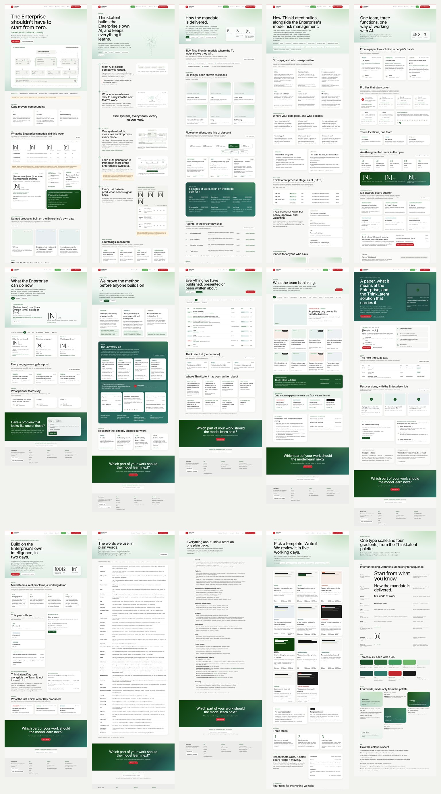

# ThinkLatent site (TL-016): start here

The ThinkLatent team site, designed in the Idea Lab and built by hand in the Enterprise's SharePoint. Everything in this folder is for SharePoint.

## See the design

- **Live and editable:** [design canvas v11.1](https://claude.ai/artifact/4uZUcDCHWPTqtzMXZrLKQD) on claude.ai, 27 boards, on the design kit's colour v5 (D-490, 23 Nov 2026): black buttons, red only on the one main action, emerald links, a white hero with one soft field, flat green and teal tints, a deep forest closing band. v11.1 (D-498, 24 Nov 2026) puts the kit's brain mark in the header and adds pictures drawn from it: hero variants, post thumbnails, product tiles and patterns, all on the Imagery board.
- **Here in GitHub:** an image of every board in `design-canvas/previews/` (they open in the browser), and the boards as HTML in `design-canvas/project/`, which open in Chrome or Edge after a `git pull`. Opened from disk, the boards show no pictures, because the canvas serves them from its own store; the previews include them.

| Page | Image | Board |
| --- | --- | --- |
| Home | [preview](design-canvas/previews/01-Main.webp) | [board](design-canvas/project/Main.dc.html) |
| Mandate | [preview](design-canvas/previews/02-Mandate.webp) | [board](design-canvas/project/Mandate.dc.html) |
| Products | [preview](design-canvas/previews/03-Products.webp) | [board](design-canvas/project/Products.dc.html) |
| How we build responsibly | [preview](design-canvas/previews/04-TLTrust.webp) | [board](design-canvas/project/TLTrust.dc.html) |
| Team | [preview](design-canvas/previews/05-Team.webp) | [board](design-canvas/project/Team.dc.html) |
| Wins | [preview](design-canvas/previews/06-Wins.webp) | [board](design-canvas/project/Wins.dc.html) |
| Research | [preview](design-canvas/previews/07-Research.webp) | [board](design-canvas/project/Research.dc.html) |
| Publications | [preview](design-canvas/previews/08-Publications.webp) | [board](design-canvas/project/Publications.dc.html) |
| Blog | [preview](design-canvas/previews/09-Blog.webp) | [board](design-canvas/project/Blog.dc.html) |
| AI Perspectives | [preview](design-canvas/previews/10-Perspectives.webp) | [board](design-canvas/project/Perspectives.dc.html) |
| ThinkLatent Day | [preview](design-canvas/previews/11-TLDay.webp) | [board](design-canvas/project/TLDay.dc.html) |
| Glossary | [preview](design-canvas/previews/12-Glossary.webp) | [board](design-canvas/project/Glossary.dc.html) |
| ThinkLatent at a glance | [preview](design-canvas/previews/13-Glance.webp) | [board](design-canvas/project/Glance.dc.html) |
| Write for ThinkLatent | [preview](design-canvas/previews/14-Write.webp) | [board](design-canvas/project/Write.dc.html) |
| Site design system | [preview](design-canvas/previews/15-System.webp) | [board](design-canvas/project/System.dc.html) |
| Imagery: heroes, thumbnails, tiles, patterns | [preview](design-canvas/previews/27-Imagery.webp) | [board](design-canvas/project/Imagery.dc.html) |
| Template: Blog post | [preview](design-canvas/previews/16-TplBlog.webp) | [board](design-canvas/project/TplBlog.dc.html) |
| Template: Win story | [preview](design-canvas/previews/17-TplWin.webp) | [board](design-canvas/project/TplWin.dc.html) |
| Template: Paper explained | [preview](design-canvas/previews/18-TplPaper.webp) | [board](design-canvas/project/TplPaper.dc.html) |
| Template: Model card | [preview](design-canvas/previews/19-TplModelCard.webp) | [board](design-canvas/project/TplModelCard.dc.html) |
| Template: Release notes | [preview](design-canvas/previews/20-TplRelease.webp) | [board](design-canvas/project/TplRelease.dc.html) |
| Template: Leadership series | [preview](design-canvas/previews/21-TplLeader.webp) | [board](design-canvas/project/TplLeader.dc.html) |
| Template: Use case | [preview](design-canvas/previews/22-TplUseCase.webp) | [board](design-canvas/project/TplUseCase.dc.html) |
| Template: AI Perspectives session | [preview](design-canvas/previews/23-TplSession.webp) | [board](design-canvas/project/TplSession.dc.html) |
| Template: Conference roundup | [preview](design-canvas/previews/24-TplRoundup.webp) | [board](design-canvas/project/TplRoundup.dc.html) |
| Template: New partner | [preview](design-canvas/previews/25-TplPartner.webp) | [board](design-canvas/project/TplPartner.dc.html) |
| Template: Quarterly awards | [preview](design-canvas/previews/26-TplAwards.webp) | [board](design-canvas/project/TplAwards.dc.html) |

## What is in this folder

| Path | What it is |
| --- | --- |
| `theme-pack/` | The materials SharePoint takes: colours, background images, the logo, pictures for posts, cards and heroes, Mandate drawings, lists, column format, custom.css |
| `docs/page-copy.md` | Every word of every page and template, in SharePoint section and web part order ([live doc](https://claude.ai/artifact/SYuzrTCs1uxD9f5b3H9Ru5)) |
| `docs/sharepoint-build-guide.md` | The build in ten steps ([live doc](https://claude.ai/artifact/8aaC53w8XNkk4UVcoErQMr)) |
| `docs/launch-brackets.md` | The 171 values only the Enterprise holds, grouped by the system they come from ([live doc](https://claude.ai/artifact/38RGiipB795FZiQZCkzwAu)) |
| `design-canvas/` | The design: boards as HTML, previews as images |
| `idea-card.md` | The idea card |
| `tools/` | The scripts that made and check these files: board previews, the contrast check, and the record of how each version was made ([tools/README.md](tools/README.md)) |

## How the theme pack helps SharePoint

SharePoint cannot import a design, so the pack holds the parts it can take, each in a form SharePoint accepts:

| From the design | In the pack | In SharePoint |
| --- | --- | --- |
| The colours | `thinklatent-theme.json`, `Add-ThinkLatentTheme.ps1` | The site theme: black buttons everywhere, and three colour pairs page authors can put on a section |
| The backgrounds | `gradients/*.png` | Meadow as the hero image; the flat three as images wherever a colour pair cannot be used |
| The logo | `logo/*.png` | Change the look > Header: site logo thumbnail and site logo |
| Pictures for posts, cards and heroes | `images/` | Page details thumbnails, Quick links and Hero tiles, section backgrounds |
| The Mandate diagrams | `drawings/*.png` (SVG sources beside them) | Image web parts |
| The lists | `lists/*.csv` | Lists created straight from the files |
| The status glyphs | `stage-column-format.json` | Column formatting on the Process stage list |
| Type sizes applied automatically, pill buttons, the red main action, emerald links, the stripe | `custom.css` | Applied by one IT customizer; until then, sizes are typed by hand and every button is black |

The words come from the page copy, the order from the build guide.

## Set it up, step by step

1. **Unzip the pack** on your laptop. Keep the [page copy](https://claude.ai/artifact/SYuzrTCs1uxD9f5b3H9Ru5) open beside SharePoint.
2. **Create the test site.** SharePoint start page > + Create site > Communication site. Name it ThinkLatent, on a test address such as /sites/thinklatent-test.
3. **Header, logo, menu and footer.** Settings (gear) > Change the look > Header: Compact, site title shown; Site logo thumbnail > Change > `theme-pack/logo/site-logo-thumbnail-white-tile-256.png`; Site logo > Change > `theme-pack/logo/brain-full-colour-256.png`; Save. Navigation: Horizontal, Mega menu. Footer: on.
4. **Colours, no admin needed.** Settings > Site branding > Theme > + New theme. With + Add color, add #0B0F0C as the primary colour and #FFFFFF, #0B5F33, #E6F2EC, #E3F0EF and #0C2822 as secondary colours. With + New combination, add three pairs: background #E6F2EC with accent #0B0F0C (Mint rise), background #E3F0EF with accent #0B0F0C (Lagoon), background #0C2822 with accent #FFFFFF (Canopy). Name it ThinkLatent v11 and save. Then Settings > Change the look > Theme > ThinkLatent v11 > Save. Every button on the site is now black. For the same theme across the tenant instead, a SharePoint administrator runs `theme-pack/Add-ThinkLatentTheme.ps1` and you pick ThinkLatent v11 in Change the look.
5. **Font (optional).** Inter needs the brand center, which an administrator sets up. Then Settings > Site branding > Font packages > + New font package, Inter for both slots, and apply it in Change the look. Without it the site uses SharePoint's own font.
6. **Images.** Settings > Site contents > Site Assets > + New > Folder, named ThinkLatent. Open it and upload the four PNGs from `theme-pack/gradients/`, the PNGs from `theme-pack/drawings/`, and the folders `heroes`, `thumbnails`, `tiles` and `patterns` from `theme-pack/images/` (Upload > Folder).
7. **Lists.** Site home > + New > List > From CSV > upload `theme-pack/lists/glossary.csv`, check the column types in the preview, name it Glossary, Create. Repeat for `publications.csv` (Publications), `wins.csv` (Wins; replace the sample row first), `process-stage.csv` (Process stage) and `citations.csv` (Citations). `launch-brackets.csv` is an optional tracker for the test site.
8. **Status column.** In Process stage: Stage column > Column settings > Format this column > Advanced mode, paste the contents of `stage-column-format.json`, Save.
9. **Page columns.** In Site Pages add Category, Owner, Second owner, Review by, Source, As of and Business line (build guide, step 4).
10. **Build a page.** + New > Page > Blank. For each section in the page copy: add a section and give it the background the copy names. Meadow: Edit section > Background > Image > `meadow-2880x1200.png` from Site Assets > ThinkLatent, overlay as low as it goes. Mint rise, Lagoon or Canopy: Edit section > pick the theme's colour pair with that background (#E6F2EC, #E3F0EF or #0C2822); if the pane offers no pairs, use the image of the same name instead. For a hero with text only, a variant from `theme-pack/images/heroes` can take Meadow's place. Leave every other section white. Add the web parts listed, paste the text, set the style and type the size (Heading 1, 48, and so on). On the page's one main action, add `?tl=main` to the end of its link (custom.css turns that button red).
11. **Mandate drawings.** Image web parts with the PNGs from `theme-pack/drawings/`, alt text from the page copy.
12. **Pictures.** Each template's Category has a pair in `theme-pack/images/thumbnails`. On every post and page: Edit > Page details > Change thumbnail, as the last step before posting, then check it on Home's News web part, because SharePoint can swap it for the first image in the post. Product cards (Quick links, Tiles layout) and Hero tiles take the files in `theme-pack/images/tiles`.
13. **Order.** Home, Wins and Products first, then the rest. Fill each bracket from the system it names as you go, and log the hours per page.
14. **custom.css (IT).** Send the request in build guide step 9. Once IT switches the customizer on, upload `custom.css` to Site Assets > ThinkLatent: the sizes apply by themselves, buttons become pills, the button marked `?tl=main` turns red, text links turn emerald and the header stripe appears. Until then everything works with typed sizes, black buttons and black links.
15. **Before launch.** Run the checklist in build guide step 10.

Everything here is private to thinklatent-labs. The live docs and canvas on claude.ai win over these mirrors.
